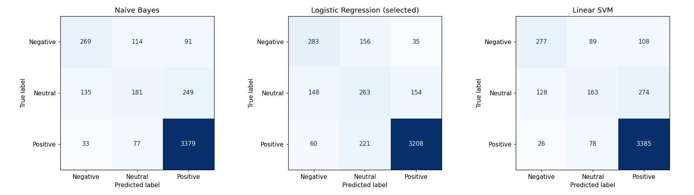
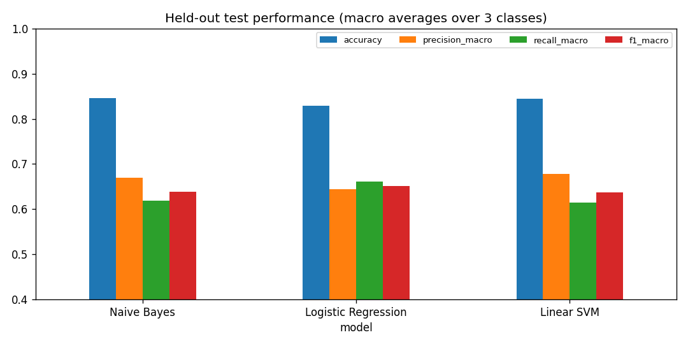

# Evaluation Report: Review Sentiment Analysis

## Data
- Women's E-Commerce Clothing Reviews: 23,486 reviews; 845 without
  text and 5 duplicate texts removed -> 22,636 reviews.
- Labels from stars (1-2 stars = Negative, 3 = Neutral, 4-5 = Positive): {'Negative': 2370, 'Neutral': 2823, 'Positive': 17443}.
- Stratified 80/20 split (18,108 train / 4,528 test).

## Method
- Text = title + review, cleaned; TF-IDF on words and 2-word phrases (fitted inside each CV fold).
- Models: Complement Naive Bayes, Logistic Regression and Linear SVM (both with balanced class weights).
- 5-fold stratified CV on the training set; best mean **macro F1** is selected (accuracy is misleading
  because 77% of reviews are positive).

## Results
| model | cv_f1_macro_mean | cv_f1_macro_std | accuracy | precision_macro | recall_macro | f1_macro | negative_recall |
|---|---|---|---|---|---|---|---|
| Naive Bayes | 0.6203 | 0.0121 | 0.8456 | 0.6702 | 0.6188 | 0.6382 | 0.5675 |
| Logistic Regression | 0.6571 | 0.0096 | 0.8291 | 0.6439 | 0.6607 | 0.6516 | 0.597 |
| Linear SVM | 0.6248 | 0.0065 | 0.8447 | 0.6784 | 0.6144 | 0.6365 | 0.5844 |

**Selected model: Logistic Regression**: test macro F1 0.6516, accuracy 0.8291,
recall on Negative reviews 0.5970.

### Per-class results (selected model)
| index | precision | recall | f1-score | support |
|---|---|---|---|---|
| Negative | 0.5764 | 0.597 | 0.5865 | 474.0 |
| Neutral | 0.4109 | 0.4655 | 0.4365 | 565.0 |
| Positive | 0.9444 | 0.9195 | 0.9317 | 3489.0 |
| accuracy | 0.8291 | 0.8291 | 0.8291 | 0.8291 |
| macro avg | 0.6439 | 0.6607 | 0.6516 | 4528.0 |
| weighted avg | 0.8393 | 0.8291 | 0.8338 | 4528.0 |

### Words that push towards each sentiment
- **Negative:** disappointed, not, poor, horrible, unflattering, awful, cheap, huge, disappointing, terrible, even, looked, was, not recommend, back
- **Neutral:** however, to love, not for, however the, ok, just ok, returning it, meh, is cute, color and, but, much, if, pretty but, arms
- **Positive:** love, great, perfect, comfortable, little, not too, love this, beautiful, comfy, unique, perfectly, soft, amazing, lovely, compliments

## Limitations
- **Neutral** (3-star) reviews are the hardest class: they usually mix praise and complaints, and
  the same text could get 2 or 4 stars from different people. Expect most errors there.
- Labels come from star ratings, which are noisy (some 5-star reviews mention problems).
- Trained on English clothing reviews; other product types or languages (e.g. Arabic) need retraining
  on the client's own reviews. Sarcasm and very short texts ("ok") are often misread.
